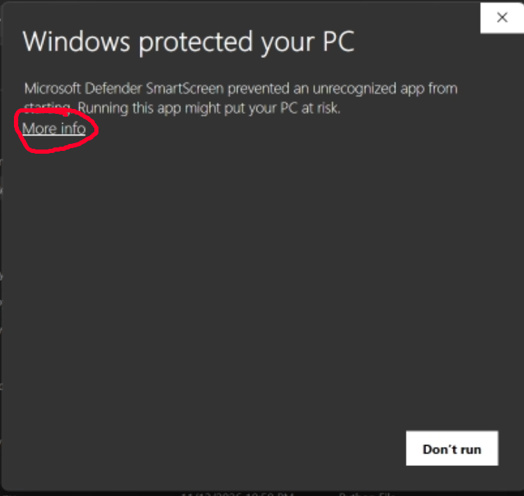
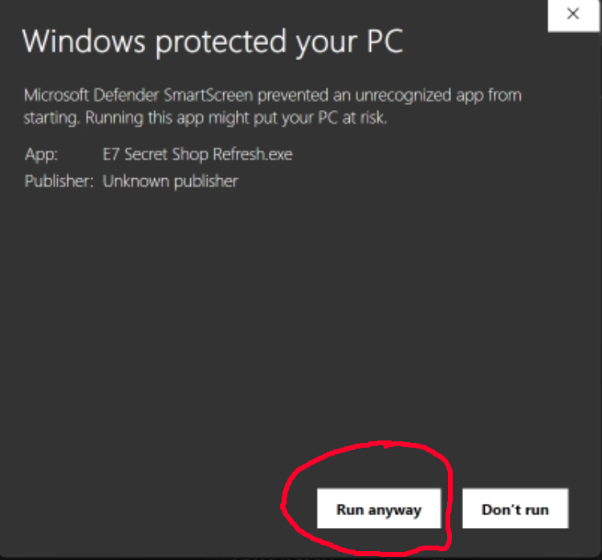
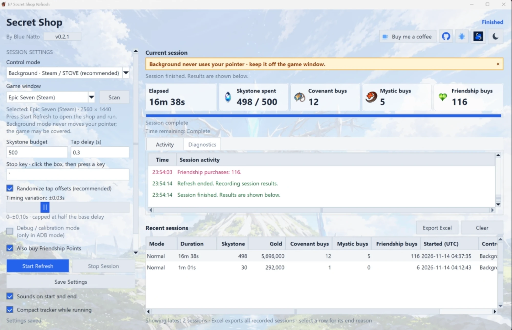
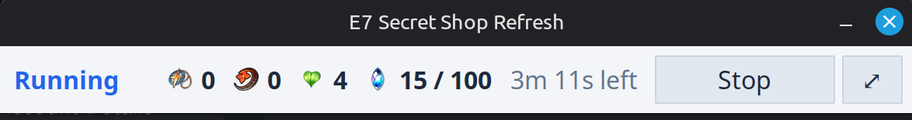

# E7 Secret Shop Refresh (Beta)

Opens Epic Seven's Secret Shop, buys Covenant Bookmarks and Mystic Medals, and
refreshes until your Skystone budget runs out. Works with **Steam** (Windows 11 and
Linux) and **STOVE** in the background, so you can keep using your PC. Windows app;
Linux runs from source.

Hi, I'm Blue Natto. This is a small, unofficial hobby project for fellow Epic Seven
players, based on Solunium's GPL-3.0 engine. Feedback and bug reports are welcome!

> ⚠️ **Beta, only tested on my own PCs.** Steam (Windows 11 and Linux), the STOVE client and
> Google Play Games Developer Emulator work for me. Other PCs, emulators and settings
> may hit edge cases I haven't seen. Start with a small Skystone budget, and if
> something breaks, report it on [GitHub Issues](https://github.com/NitrogenSulfide/Epic-Seven-E7-Secret-Shop-Refresh/issues)
> or Reddit with the log line the app shows.

## EZ Mode · download, extract, start

**[Download the Windows app — v0.2.5](https://github.com/NitrogenSulfide/Epic-Seven-E7-Secret-Shop-Refresh/releases/download/v0.2.5/E7ShopRefresh-0.2.5.zip)**

> **Ban risk:** This is unofficial automation. [Smilegate's terms](https://common.game.onstove.com/terms/index?gameType=MOBILE&langCode=en&termsType=1) prohibit unauthorized scripts and macros. Account penalties, including bans, are possible; use at your own risk.

1. Extract the **whole ZIP**, then open **E7 Secret Shop Refresh.exe**. Python is included.
   Windows 11 may show **Windows protected your PC**: click **More info**, then
   **Run anyway** (the app is not code-signed). Then choose **Yes** at the
   administrator prompt; it appears every time the app opens.

    
2. Open Epic Seven (English) on the home screen or in the Secret Shop, with no popups open.
3. On **Steam or STOVE**, leave **Background** selected. On an emulator or Google
   Play Games, use [Mouse or ADB](#emulators--mouse-and-adb) instead.
4. Set your **Skystone budget** and check the **Stop key**, then press **Start Refresh**.

**To stop:** press the Stop key (default: backtick `` ` ``, below Esc) from any
window, or click **Stop Session**.

**[Detailed setup / troubleshooting](release/SETUP.md)** ·
**[What's new in v0.2.5](https://github.com/NitrogenSulfide/Epic-Seven-E7-Secret-Shop-Refresh/releases/tag/v0.2.5)**

**Tips for a smooth run**

- **Two monitors work best:** game on one, everything else on the other.
- **One monitor:** leave the game open behind your other windows. Covering it is
  fine, but **never minimize it**; a minimized game stops drawing and the run stops.
- Keep your pointer off the game window, still or moving: the game cancels the
  app's clicks while the pointer rests on it, so the app pauses until you move it
  off, and stops after 10 seconds. Park it on the compact tracker bar, the
  taskbar or another screen. With one fullscreen monitor, the compact bar is the
  place.
- Start from the home screen or the Secret Shop, with no Refresh or Buy dialog open.
- Don't resize the game, toggle fullscreen, or open a second Epic Seven window
  during a run.
- Keep the PC awake: don't let it sleep or lock during a run.
- Try a small budget first.

## What it looks like

The main window after a finished Background run on Steam. Run history is blurred.



While it runs, the app can shrink to a small always-on-top bar with purchases,
Skystones spent, time left and a Stop button:



## Tested game clients

| Game client | Background | Mouse | ADB |
| --- | --- | --- | --- |
| Epic Seven on **Steam** (Windows 11) | Tested | Not tested | Unavailable |
| Epic Seven on **Steam** (Linux, Proton) | Tested | Unavailable | Unavailable |
| Official **STOVE** client | Tested | Tested | Unavailable |
| Google Play Games on PC **Developer Emulator** | Unavailable | Tested | Tested |

Other clients and emulators have not been tested. The game must be in English,
in landscape, at least 640 × 360.

## Background mode · Steam and STOVE

Clicks go straight to the game window and frames are read from the window itself,
so your pointer never moves and other windows can cover the game. The game runs as
administrator, so the app does too: Windows asks each time it opens.

## Linux · Steam on Proton

Same Background mode, driven from inside the game's Wine session. Tested on Linux
Mint 22 (Cinnamon, X11) with Proton Experimental. Wayland isn't supported yet: log
in to an X11 session.

```bash
git clone https://github.com/NitrogenSulfide/Epic-Seven-E7-Secret-Shop-Refresh.git
cd Epic-Seven-E7-Secret-Shop-Refresh
./e7-shop-refresh-linux.sh setup    # prints a sudo apt/dnf/pacman command if packages are missing
./e7-shop-refresh-linux.sh          # start the app
./e7-shop-refresh-linux.sh menu     # optional: add it to your app menu (menu-remove undoes it)
```

On Debian, Ubuntu or Mint the packages are
`sudo apt install python3-venv python3-tk tesseract-ocr gcc-mingw-w64-x86-64`.
Python packages go into `.venv` inside the folder; nothing is installed system-wide.

## Emulators · Mouse and ADB

**Mouse** moves your real pointer, so leave the PC alone during a run and keep the
game uncovered. Pick **Control mode → Mouse**, then choose the game window.

**ADB** runs through the emulator and leaves your pointer free:

1. Enable and authorize ADB debugging in your emulator.
2. Pick **Control mode → ADB** and select the device (Google's Developer Emulator
   is **localhost:6520**). Use **Scan** if it isn't listed; BlueStacks 5 players
   show up by name when ADB is enabled.
3. Press **Start Refresh**.

See the [setup guide](release/SETUP.md) if the device isn't detected. BlueStacks
hasn't been live-tested yet.

## Features

- Skystone budget, live purchase counters and a configurable Stop key.
- Optional **Also buy Friendship Points** (off by default).
- Session history with Excel export; day/night themes; in-app Quickstart.
- Randomized tap positions and adjustable timing variation.
- Checks shop buttons and confirmation text before every click, and stops on
  anything unexpected rather than guessing. See
  [regression coverage](docs/AUTOMATION-REGRESSIONS.md).

**Updating:** there's no auto-updater. Copy your `runtime` folder (settings and
history) into the new extracted release.

## Source and credits

**E7Source-0.2.5.zip** on the release page has the source and rebuild steps. See
[build instructions](release/BUILDING.md) and [engine notes](ENGINE.md).

Software is GPL-3.0; see [LICENSE](LICENSE), [CREDITS.txt](CREDITS.txt) and
[upstream notices](UPSTREAM.md). Third-party artwork and audio keep their own
rights. This is an independent community tool, not endorsed by Smilegate.

Optional support: [Buy me a coffee](https://ko-fi.com/bluenatto).
