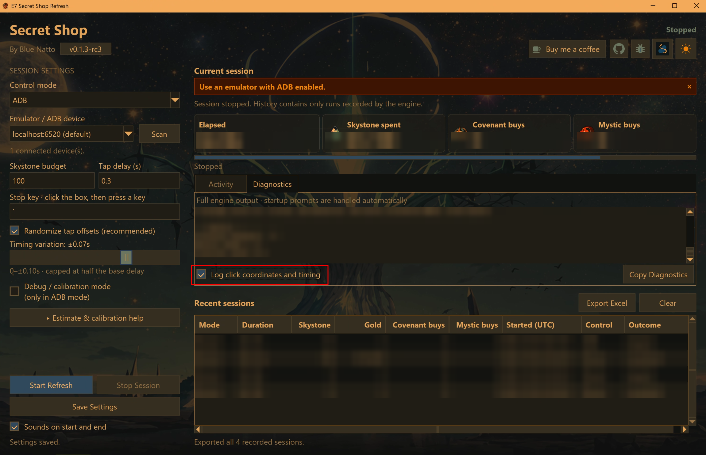
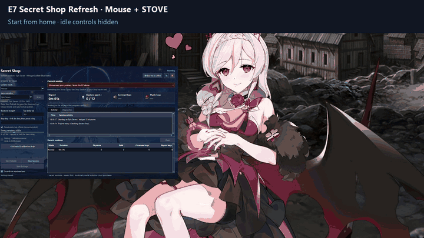

# E7 Secret Shop Refresh

Automatically open Epic Seven's Secret Shop, buy Covenant Bookmarks and Mystic
Medals, and refresh within your Skystone budget. Windows app (Linux from source) by
**NitrogenSulfide (Blue Natto)**, based on Solunium's GPL-3.0 engine.

Hi, I'm Blue Natto. This is a small, unofficial hobby project for fellow Epic Seven
players. I've mainly tested it on my own PC and laptop, so some setups may still
need fixes. Feedback and bug reports are welcome—I'll do my best to help when I can.

## EZ Mode · download, extract, start

**[Download the Windows app — v0.2.0](https://github.com/NitrogenSulfide/Epic-Seven-E7-Secret-Shop-Refresh/releases/download/v0.2.0/E7ShopRefresh-0.2.0.zip)**

> **Ban risk:** This is unofficial automation. [Smilegate's terms](https://common.game.onstove.com/terms/index?gameType=MOBILE&langCode=en&termsType=1) prohibit unauthorized scripts and macros. Account penalties, including bans, are possible; use at your own risk.

1. Extract the **whole ZIP**, then open **E7 Secret Shop Refresh.exe**. Python is included.
2. Open **English Epic Seven** at home or in Secret Shop. Close any popups; hidden idle home controls are handled automatically.
3. Leave **Mouse** selected (or choose **Background** for Epic Seven on Steam) and choose your **game window**. Use **Scan** if needed.
4. Set your **Skystone budget** and check the **Stop key**, then press **Start Refresh**.

If the app offers to **restart as administrator**, accept the restart and Windows
permission prompt. Once it reopens, select your game and press **Start Refresh**
again. This is only needed when the selected game runs with administrator permission.

**While Mouse runs:** leave the PC alone, keep the game uncovered, and avoid moving
or resizing its window. **To stop:** press your configured Stop key (default: the
backtick key, usually below Esc) or click **Stop Session**. Start with a small budget
for your first run.

**[Detailed setup / troubleshooting](release/SETUP.md)** ·
**[What's new in v0.2.0](https://github.com/NitrogenSulfide/Epic-Seven-E7-Secret-Shop-Refresh/releases/tag/v0.2.0)**

## Session history and diagnostics



The screenshot shows the tested rc3 interface included in v0.1.3.

## See it work · Mouse on STOVE

Hidden home controls → Secret Shop → automatic Covenant Bookmark purchase.
This real-time clip ends just after the purchase; account details are covered.

[](https://github.com/NitrogenSulfide/Epic-Seven-E7-Secret-Shop-Refresh/releases/download/v0.1.1/mouse-stove-demo.mp4)

**[Watch / download the MP4](https://github.com/NitrogenSulfide/Epic-Seven-E7-Secret-Shop-Refresh/releases/download/v0.1.1/mouse-stove-demo.mp4)** · approximately 14 seconds

## Tested game clients

| Game client | Mouse | ADB | Background |
| --- | --- | --- | --- |
| Google Play Games on PC **Developer Emulator** | Tested | Tested | Unavailable |
| Official native STOVE client | Tested | Unavailable | Unavailable |
| Epic Seven on **Steam** (Windows 11) | Not yet tested | Unavailable | Tested |
| Epic Seven on **Steam** (Linux, Proton) | Unavailable | Unavailable | Tested |

Testing is limited to these clients. Other emulators and methods have not been
tested. Use English game text and a readable landscape 16:9 game view of at least
640 × 360. Native STOVE Mouse mode also supports its wider maximized client area.
ADB calibration requires a 1920 × 1080 Android display.

## Background mode · Steam on Windows (preview)

For **Epic Seven on Steam**, choose **Control mode → Background**. Clicks are sent
to the game window directly and frames are read from the window itself, so your
mouse pointer is never moved and other windows may cover the game. Steam's E7 runs
as administrator, so the app offers to **restart as administrator** the first time;
accept it, then press **Start Refresh** again.

You can keep using your PC. Input waits while the pointer is *moving* over the
game and resumes once it has been still for a second; a still pointer, or one over
another window or the taskbar, is fine. Don't minimize or resize the game during a
run. The Stop key works from any window.

## Linux · Steam on Proton (Background mode, preview)

On Linux the app drives **Epic Seven on Steam** (Proton) in the background. Clicks are
posted to the game window from inside its Wine session and frames are read from the
game's own X window. Your mouse pointer and keyboard focus are never used, and other
windows may cover the game. Only tested on Linux Mint 22 (Cinnamon, X11) with
Proton Experimental. Wayland is not supported yet: log in to an X11 session.

```bash
git clone https://github.com/NitrogenSulfide/Epic-Seven-E7-Secret-Shop-Refresh.git
cd Epic-Seven-E7-Secret-Shop-Refresh
./e7-shop-refresh-linux.sh setup    # prints a sudo apt/dnf/pacman command if packages are missing
./e7-shop-refresh-linux.sh          # start the app
./e7-shop-refresh-linux.sh menu     # optional: add it to your app menu (menu-remove undoes it)
```

Setup needs Python 3 with venv and Tk, Tesseract OCR, and (once, to build the small
input helper) the MinGW-w64 cross compiler. On Debian, Ubuntu or Mint:
`sudo apt install python3-venv python3-tk tesseract-ocr gcc-mingw-w64-x86-64`.
Python packages go into `.venv` inside the folder; nothing is installed system-wide.

Start the game, open it at home or in Secret Shop, then press **Start Refresh**.
Keep the pointer off the game window: input pauses while it is over the game.
Don't minimize or resize the game during a run. The Stop key works from any window.

## ADB mode · optional

ADB lets you use your PC pointer normally while the app runs through the emulator.
Native STOVE does not support ADB.

1. Enable and authorize ADB debugging in your emulator.
2. Switch **Control mode → ADB**, then select the device. Google Developer Emulator uses **localhost:6520**; use **Scan** if needed.
3. Open Epic Seven at home or in Secret Shop, check your budget and Stop key, then press **Start Refresh**.

See the [setup guide](release/SETUP.md) if the device isn't detected.

BlueStacks 5 players appear in **Scan** by instance name and current port when
their player windows are open and ADB is enabled. Select the intended player;
its port can differ from 5555 and change between starts. Scanning only discovers
endpoints. **Start Refresh** connects to the selected endpoint and checks that
Epic Seven is active. Switching from a selected BlueStacks Mouse window chooses
that same player in ADB mode. BlueStacks game-surface and permission handling
have offline regression coverage; live refresh/purchase testing remains pending.

## Features and updates

Live counters, used/total Skystone budget, configurable Stop key, smooth Mouse
movement and dragging, randomized tap offsets, adjustable timing variation up to
±0.10 seconds, session history, day/night themes, and in-app Quickstart/release notes.
Excel export includes the full saved history with timestamps, outcomes and stop reasons.
Optional click/timing diagnostics work in Mouse and ADB; enable them in Diagnostics
before starting. Calibration is ADB-only. Covenant Bookmarks and Mystic Medals
are purchased by default. The source adds an optional **Also buy Friendship Points**
setting for normal ADB and Mouse sessions, requiring a matching rebuilt engine.
It buys the current heart-icon 50-point item for 18,000 gold using observed
name/category/price recognition, and counts purchases rather than points awarded.
The old upstream clover bookmark image is retained for provenance and is not
used for this feature. See [Friendship verification](ENGINE.md#friendship-points-source-feature).

The app verifies shop controls and confirmation text before continuing. Unknown or
changed screens can stop a session. Passing tested cases does not establish support
for every wallpaper/layout or uninterrupted long runs; insufficient-currency
stopping has not been live-tested. See [regression coverage](docs/AUTOMATION-REGRESSIONS.md).

**Updating:** back up your settings and history under `runtime` before switching to
a new extracted release. There is no automatic updater or migration. Personal
runtime data is excluded from release ZIPs.

## Source and credits

The optional **E7Source-0.1.3.zip** contains the maintained source and rebuild
instructions. Matching GUI/engine source is also supplied with the player package.
See [build instructions](release/BUILDING.md) and [engine notes](ENGINE.md).

Software is GPL-3.0; see [LICENSE](LICENSE), [CREDITS.txt](CREDITS.txt) and
[upstream notices](UPSTREAM.md). Third-party artwork/audio retain their respective
rights and provenance. This is an independent community tool with no official
endorsement. Upstream source history is preserved.

Optional support: [Buy me a coffee](https://ko-fi.com/bluenatto).

## Private trial 0.1.4-rc9

Finds the STOVE Secret Shop icon under warm display tints (f.lux, Night light)
and with the new Milestone of Radiance entry. Fixes a false stop when a pre-purchased Friendship row sits at the bottom of
the scrolled shop, and re-reads unclear rows from fresh captures before stopping.
Recognizes 0/1 stock beside Buy on pre-purchased currency rows, retains the
injected-key listener for brief streamed Stop presses, and uses the supplied
game's green leaf-heart cutout. Includes a global Stop key and a Friendship buys
counter beside Mystic, with corresponding diagnostics and Excel columns.
Recognizes either Event or Epic Pass beside the home Secret Shop menu in both
transports. BlueStacks Mouse accepts only the verified direct Qt input host
when Windows skips its disabled render child. Offline failure-frame and fake
cross-client regressions cover these changes; live input is a separate check.
